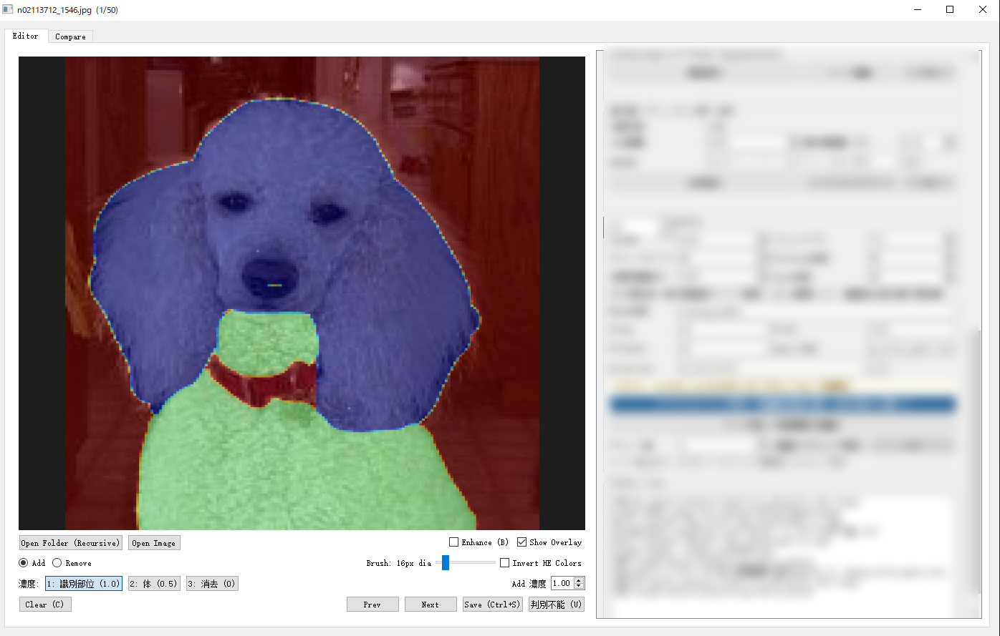
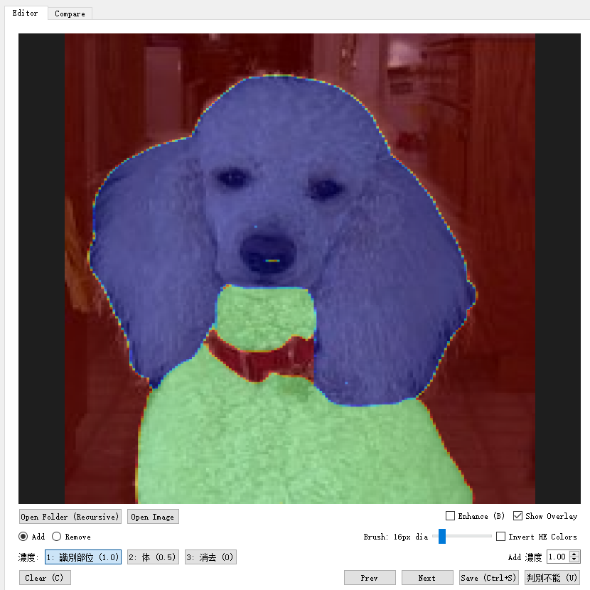
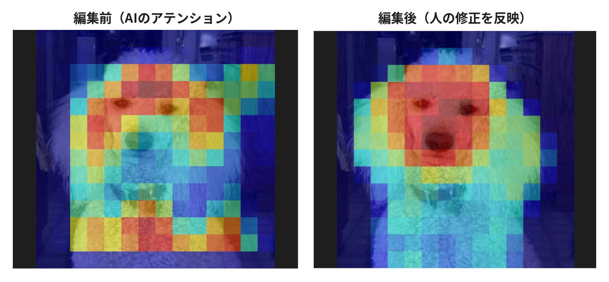

# Human-Guided Attention Editor

AIが画像のどこを見て判断したか（アテンション）を、人が直接編集して学習に反映できるGUIツールです。大学院の研究で開発しました。

> このツールは査読中の論文に関わるため、ソースコードは公開していません。このリポジトリでは、ツールの概要と画面を紹介しています。

## 背景

画像分類AIは精度が高くても、背景や無関係な部分を根拠に判断していることがあります。Attention Branch Network（ABN）はアテンションマップで判断根拠を可視化できますが、間違った根拠を人が直す手段は限られていました。

そこで、人がアテンションを直接描き直し、その修正をモデルの学習に反映できるツールを作りました。

## 主な機能

- 学習済みABNモデルの読み込みと、画像ごとのアテンションマップの表示
- アテンションの編集（濃淡をつけて塗る・消す）
- 判断にほとんど寄与していないチャネル（dead channel）の抽出
- 特定のチャネルをゼロにして、判断への影響を確かめる検証（zero-masking）
- 編集したアテンションを使ったファインチューニング

## 提案手法

1. 約200枚の画像だけ、人がアテンションを濃淡つきで編集する
2. 編集したデータで「先生役」のモデルを作る
3. 先生役のモデルを使って、全学習画像にアテンションのマスクを広げる
4. そのマスクを使ってABNを学習し、精度とアテンションの両方を改善する

すべての画像を人手で直すのではなく、少ない編集で全体を改善できる点が特徴です。

## 検証

- モデル：ResNet101ベースのABN
- データセット：Stanford Dogs

## 使用技術

- Python
- PyTorch
- PyQt5（GUI）

## 成果

- 国際会議 ICIIT 2027 に論文を投稿（共著）

## スクリーンショット

<!-- 画像を images/ フォルダに入れて、下のファイル名を合わせてください -->

### メイン画面

### アテンションの編集

### 編集前後の比較

